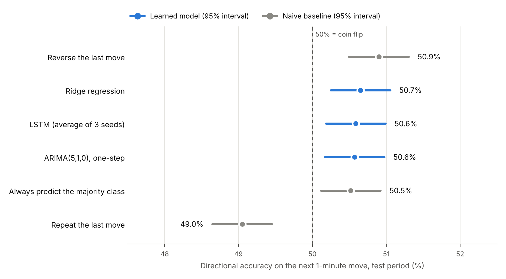

# EUR/USD 1-minute forecasting: LSTM vs ARIMA vs naive baselines

Can a deep learning model predict the next 1-minute move of EUR/USD? This project tests an LSTM network against ARIMA(5,1,0), ridge regression and simple rules on **322,578 one-minute bars from 2023**, using an evaluation designed to rule out data leakage.

**Key findings**

- **No method predicts the next 1-minute move better than chance.** Every approach scores between **49% and 51%** directional accuracy on the test period (27 Oct – 29 Dec 2023).
- **The LSTM scores 50.6%**, no better than always predicting "up" (50.5%), and its training runs settle on almost constant answers, a sign there is no learnable pattern in the features.
- **No model beats the random walk** ("next price = last price") on prediction error, which stays at about 0.80 pips for every method.
- **The largest effect is a tiny reversal tendency** (50.9%), far too small to trade once costs are included.



## Why the evaluation matters

High-frequency financial data makes it easy to get impressive-looking accuracy that does not survive contact with reality. This project is built to avoid the common traps:

| Pitfall | What can go wrong | What this project does |
|---|---|---|
| Smoothed targets | Predicting a moving average of the price: its direction is largely known in advance, so accuracy looks high | Predicts the next **real** 1-minute return |
| Scaling before splitting | The scaler sees test-period prices | Scaler fitted on the training period only |
| Deleting outliers | Removing rows breaks the time series and joins non-consecutive minutes | Features clipped at ±8 standard deviations |
| Unequal comparisons | One model gets fresh data each step while another forecasts far ahead | Every model makes one-step forecasts from the same information |
| No baseline | No way to tell whether a model adds anything | Four naive baselines on the same test minutes |
| Misleading metrics | Errors in mismatched units, accuracy without uncertainty | Errors in pips, Cohen's kappa, ROC-AUC from continuous scores, 95% intervals |

## Method

**Data.** EUR/USD 1-minute bid OHLC bars for 2023 from HistData.com (322,578 bars). HistData omits minutes without ticks; targets more than 5 minutes after the previous bar (weekends, holidays) are excluded.

**Target.** The log return from the current bar to the next one. Direction is up or down; minutes with no price change (8.7% of the test set) are excluded from the direction metrics.

**Features.** 16 scale-free features computed only from bars up to the current one: 1-, 5- and 15-minute returns, 30-minute volatility, candle range and body, RSI(14), MACD line, signal and histogram (relative to price), Bollinger Band position and width, distance to the 50- and 200-bar moving averages, and time of day.

**Split.** 70% training, 10% validation, 20% test, in time order (225,074 / 32,154 / 64,307 samples).

**Models.**

- **Naive baselines:** next price = last price; always predict the majority class; repeat the last move; reverse the last move.
- **Ridge regression** on the latest feature values.
- **ARIMA(5,1,0)** on log prices, fitted on the training period and applied one step ahead.
- **LSTM:** 60-bar input window, LSTM(64) → Dropout(0.2) → Dense(16, ReLU) → Dense(1), Huber loss, Adam, early stopping on validation loss. Trained with three random seeds; the reported score averages their predictions.

## Results

Test period: 27 October – 29 December 2023, 58,730 minutes with a price change.

| Model | Directional accuracy | 95% interval | Cohen's κ | ROC-AUC | MAE (pips) |
|---|---|---|---|---|---|
| Naive: next price = last price | – | – | – | – | 0.804 |
| Naive: always predict the majority class (up) | 50.5% | 50.1–50.9% | 0.000 | – | – |
| Naive: repeat the last move | 49.0% | 48.6–49.5% | -0.018 | 0.489 | – |
| Naive: reverse the last move | 50.9% | 50.5–51.3% | 0.019 | 0.511 | – |
| Ridge regression | 50.7% | 50.2–51.1% | 0.012 | 0.507 | 0.805 |
| ARIMA(5,1,0), one-step | 50.6% | 50.2–51.0% | 0.012 | 0.506 | 0.805 |
| **LSTM (average of 3 seeds)** | 50.6% | 50.2–51.0% | 0.013 | 0.508 | 0.804 |

**What the results mean**

- **There is no usable signal.** Every approach lands within about one percentage point of a coin flip, and Cohen's kappa never exceeds 0.02.
- **The reversal tendency is real but tiny.** Over 58,730 minutes, "reverse the last move" is statistically better than chance, most likely a quirk of quote data (prices bouncing between nearby levels). It is far too small to trade: the average 1-minute move in the test period was 0.80 pips, about the size of typical retail trading costs.
- **The LSTM found nothing to learn.** Validation loss stopped improving within a few epochs, and each training run settled on an almost constant answer: one predicted "up" for 92% of minutes, another for 1%, another for 8%.
- **No model beats the random walk** on prediction error.

This is consistent with the view that liquid currency markets are close to efficient at very short horizons when only past prices are used.

## Limitations and next steps

- One currency pair, one year, one horizon (1 minute), and price-based features only.
- Directional accuracy ignores how large each move is; a trading evaluation would need transaction costs and position sizing.
- Natural next steps: longer horizons (15 minutes to 1 day), walk-forward validation across several years, order-flow or volume data, and a cost-aware backtest.

## Repository layout

```
src/
  data.py        loading HistData files and building features
  metrics.py     direction and error metrics
  experiment.py  baselines, ridge regression, one-step ARIMA and the LSTM
  figures.py     builds the chart above from the results file
results/         metrics as JSON and the chart
data/            put the HistData file here (not included; see data/README.md)
```

## How to run

```bash
pip install -r requirements.txt
# download DAT_XLSX_EURUSD_M1_2023.xlsx into data/ (see data/README.md)
python -m src.experiment --data data/DAT_XLSX_EURUSD_M1_2023.xlsx
python -m src.figures
```

On 2 CPU cores the experiment takes about 25 minutes. Results were produced with TensorFlow 2.21, statsmodels 0.15 and scikit-learn 1.9; other versions may give slightly different LSTM numbers.

## About

**Adhith Unnikrishnan** · MSc Artificial Intelligence, Brunel University London · B.Tech Civil Engineering, NIT Calicut · [LinkedIn](https://www.linkedin.com/in/adhith-unnikrishnan)

This project developed out of my MSc dissertation on forecasting EUR/USD with LSTM networks.

Data: EUR/USD 1-minute bars for 2023 from [HistData.com](https://www.histdata.com). Code released under the MIT License.
